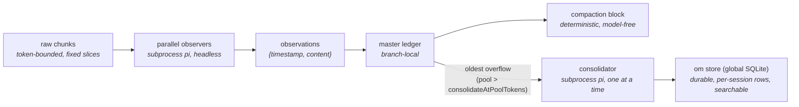

# observational-memory

Tiered, subprocess-backed memory for pi.

Parallel observer processes distill raw conversation chunks into atomic
observations. The observations go to the master's branch-local ledger, so
memory stays correct when you use pi's session branching (`/tree`). A
deterministic, model-free compaction step renders the ledger into the
compaction block. A consolidator process moves the oldest observations into
the durable om store: one global SQLite database with rows keyed per
session. The master reads the store with the read-only `om_memory` tool. A
forked session starts with a copy of its parent's memory rows.

## On/off gate (default: off)

Memory workers cost tokens and money, so the extension does nothing until
you turn it on for a session.

- `/om` — toggle for this session
- `/om on` / `/om off` — set explicitly

The setting persists per session in the ledger (`om.enabled`) and survives
resume. When the gate is off, every trigger, hook, widget, and subprocess
returns immediately.

## How it works



- **Observer clock** (`turn_end` / `agent_start`): when the conversation
  gains `chunkTokens` new tokens, the orchestrator cuts a fixed-token slice
  and starts an observer subprocess. Observers run in parallel;
  `observerConcurrency` sets the limit. Each observer commits its own
  `coversUpToId` watermark, so observers may finish in any order.
- **Observation** = `{ timestamp, content, tokenCount }`. The event
  timestamp is also the id. The orchestrator converts the minute-resolution
  timestamp from the observer into a unique second-resolution id at commit.
- **Compaction** (`agent_end`, when the context exceeds
  `compactAtContextTokens` and the session is idle): the orchestrator waits
  for observers in flight, then builds the compaction block from the active
  buffer, a **memory map** (rendered live from the store's topic index),
  and a **journey** section (the session's journey row, verbatim). The
  cutoff snaps to an observation chunk boundary, so the verbatim tail never
  double-represents history.
- **Consolidator clock** (`turn_end` / `agent_start`): when the observation
  pool exceeds `consolidateAtPoolTokens`, one background consolidator
  subprocess folds the oldest observations into the durable om store, until
  the pool returns to `poolTargetTokens`. The orchestrator then tombstones
  exactly the observations that the consolidator reports. Store rows belong
  to the session, keyed by the immutable session-header id, so two sessions
  in the same project never share output. The rows follow the session, not
  the branch: `/tree` does not roll them back. When you fork or clone a
  session, the new session copies the parent's rows once, on first touch,
  and only if its own store is empty (`om fork-copy`). This matches the
  ledger, which already travels with the fork. The consolidator addresses
  topics by slug through its own `ls`/`grep`/`read`/`write`/`edit` tools,
  which the worker extension provides as shims over the store. The reserved
  slug `JOURNEY` addresses the session's journey row.
- **Journey** (the session's journey row in the store): one descriptive
  prose history of how the work reached its current state. The consolidator
  maintains it, and the orchestrator includes it in every compaction block
  for orientation, not for recall. Each consolidation adds a short dated
  segment. The consolidator compresses the oldest segments only after the
  journey exceeds `journeyTargetTokens`, so recent history stays detailed
  and the section stays bounded. Like the topics, the journey does not roll
  back under `/tree`.

Each worker run is an ordinary recorded pi session, stored under
`~/.pi/agent/sessions` inside the project path. Open a run in the session
browser to see its input chunk, tool calls, and output. Transient handoff
files live in `~/.pi/agent/om/runs/`.

### Cost tracking

Each worker is a `pi` subprocess, so the extension takes its cost from pi's
built-in `usage.cost.total`. The worker extension, not the model,
accumulates the figure and returns it in the run's cost file
(`~/.pi/agent/om/runs/<runId>.cost.json`), next to the observation IPC
file. The orchestrator adds each run's cost to an `om.cost` ledger entry.

- **Ephemeral-safe:** the cost travels in the result-file IPC, never in a
  saved session log. This works even when pi does not persist the worker
  session.
- **Never rolls back:** the running total sums all `om.cost` entries across
  every branch of the session, so `/tree` cannot reduce real money already
  spent. The durable store follows the same rule.
- **Surfaced** in the footer (`$0.000`, right of the gauges) and in
  `/om:status` (`session cost: $X (N runs)`). Survives resume.

## Commands

| Command | Effect |
|---|---|
| `/om`, `/om on`, `/om off` | The per-session on/off gate |
| `/om:status` | Active profile, workers in flight, active observation count, next-observer progress, pool/consolidator state, topic count, journey size, context usage, **session cost**, last error |
| `/om:compact` | Force a compaction now (ignores the threshold) |
| `/om:consolidate` | Force a consolidation now (ignores the pool threshold) |

## Configuration

Put the settings in the `observational-memory` block of
`~/.pi/agent/settings.json` (global) or `.pi/settings.json` (project).
Project settings override global settings. All keys are optional; the
defaults appear below. The example uses the `anthropic` provider; choose
any provider that pi supports.

```jsonc
{
  "observational-memory": {
    "chunkTokens": 5000,
    "chunkOverlapTokens": 0,
    "poolTargetTokens": 10000,           // buffer drains back toward this after consolidation
    "consolidateAtPoolTokens": 20000,    // pool size that triggers a consolidation (200% of target)
    "compactAtContextTokens": 100000,    // set below the context window of your main model
    "tailTokens": 20000,                 // verbatim tail; snaps to a chunk boundary
    "journeyTargetTokens": 1000,         // pushed journey size; compress oldest segments past this
    "observerConcurrency": 4,
    "models": {
      "observer":     { "provider": "anthropic", "id": "claude-sonnet-4-6", "thinking": "low" },
      "consolidator": { "provider": "anthropic", "id": "claude-sonnet-4-6", "thinking": "medium" }
    },
    "passive": false,
    "debugLog": false,
    "displayMode": "bar"               // "bar" | "dense" | "off" — TUI footer rendering
  }
}
```

A block may name a **named profile**. A profile groups the knobs above for
one main-model size, for example a 20k-context profile where compaction and
consolidation must run more often. Direct keys in the same block override
individual profile knobs. Models merge per model across the profile and
the direct keys.

```jsonc
{
  "observational-memory": {
    "profile": "small-ctx",
    "profiles": {
      "small-ctx": {
        "chunkTokens": 4000, "tailTokens": 3000, "poolTargetTokens": 3000,
        "consolidateAtPoolTokens": 5000, "compactAtContextTokens": 18000
      }
    },
    "journeyTargetTokens": 800   // direct key overrides just this profile knob
  }
}
```

If the profile name is unknown, pi ignores it and uses the direct keys.
Settings precedence, lowest first: defaults, global settings, project
settings, environment variables. `/om:status` shows the active profile.

`PI_OM_PASSIVE=1` forces `passive` mode, which disables all triggers. Use
this for clean `/tree` testing. `passive` is for advanced users and is
separate from the on/off gate.

### Display mode (`displayMode`)

`bar` (default) puts the gauges in the footer status line and stacks the
worker indicators as transient widgets above it. `dense` keeps the footer as
a bare `om` label and renders one permanent two-line widget instead: line 1
has the three gauges with numeric `value/max` readouts and the worker
indicators; line 2 has a detail line (active observations, topics, journey
size against target, consolidator state, session cost, last worker error).
`off` renders no footer and no widget. The mode can live in a named profile
and is reported by `/om:status`. The footer has only one line, so `dense`
must render as a widget above the input instead of in the status line.

Switch the mode live with **`/om:display bar|dense|off`**. This applies to
the current session only, with no file edit and no reload. Type
`/om:display ` to see the three modes as completions. `/om:display` with no
argument shows the active mode. `/om:status` marks an override against the
configured value.

## Development

To set the project up on a machine, see [SETUP.md](SETUP.md).

```bash
npm install
npm test          # vitest
npm run typecheck # tsc --noEmit
```

Layout: `src/` is the master-side orchestrator (entry `src/index.ts`);
`agent/` is the shared worker extension, which subprocesses load with `-e`
(`OM_WORKER=observer|consolidator`); the Go CLI in `cli/` is the only
component that touches the database. The CLI binary is build output and is
not committed; build it with `bash cli/build.sh` (see SETUP.md §3).
Long-term memory lives in one global SQLite database
(`~/.pi/agent/om/om.db`; override with `OM_DB` or `--db`). Rows are keyed
by the immutable session-header id, so sessions in the same project stay
isolated. A fork copies its parent's rows once on first touch
(`om fork-copy`). The master reads the store through the read-only
`om_memory` tool (`list` | `get <slug>` | `search <pattern>`); writes
happen only in the background consolidator. Transient worker IPC lives
under `~/.pi/agent/om/runs/`.
